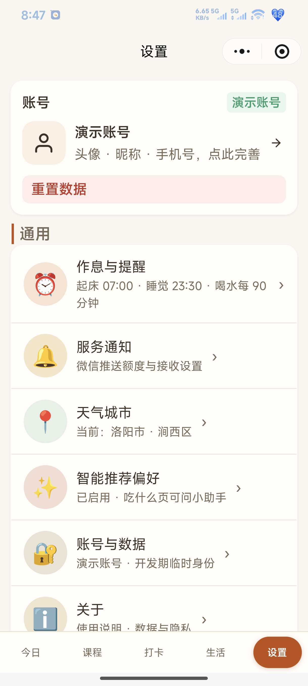

<script setup>
import ProjectHero from '../.vitepress/theme/components/ProjectHero.vue'
</script>

<ProjectHero 
  title="上岸伴学：考公备考激励小程序"
  subtitle="SHANGAN BANXUE · EXAM-COACHING MINI PROGRAM"
  date="2026.09 - 2026.10"
  role="全栈开发 & 产品设计（三端）"
  :honors="[
    '微信小程序已上线（搜索「上岸伴学」）',
    '三端体系：小程序 + FastAPI + 管理后台',
    '18 个功能页面全量交付'
  ]"
/>

## 一、项目概述

考公是一场长周期的孤独拉锯：计划列了却难坚持、状态起伏无人共情、琐事挤占复习节奏。**上岸伴学**不做题库，而是围绕备考生活的「**督促 + 激励 + 事务**」管家，用「任务 → 达成 → 奖券」的正反馈循环替代意志力消耗。

| 痛点 | 传统做法 | 上岸伴学 |
|------|---------|---------|
| 计划难坚持 | 手写计划表，三天弃坑 | 打卡热力图 + 连续全勤激励，坚持被看见 |
| 目标遥不可及 | 只有一个大日期 | 考试节点自动拆解（准考证/笔试/成绩发布） |
| 状态起伏无人共情 | 硬扛 | 心情五档记录 + 趋势回顾 + 低落日回顾 |
| 琐事挤占复习 | 想到哪做到哪 | 记账/待办/周期提醒/吃什么一站式托管 |
| 复习无正反馈 | 题海无尽头 | 任务达成发放奖券，集满触发惊喜盲盒 |

产品已上线微信小程序平台，搜索「上岸伴学」即可体验。

## 二、三端架构

由旧版单用户 PWA 演进为多用户小程序三端体系，一次开发覆盖三类角色：

| 端 | 技术栈 | 职责 |
|---|---|---|
| **C 端小程序** | Taro 4 + React 18 | 18 个功能页：倒计时督促、打卡、奖券激励、生活管理；正式用户数据全量上云，游客走本地沙盒 |
| **后端服务** | FastAPI + SQLite | 静默登录建档、AppData 18 域同步、任务/奖券中枢、天气/AI/一言外部服务代理 |
| **B 端管理后台** | Vue 3（静态托管） | 用户统计看板、任务发布、奖券发放、数据备份导入 |

```
┌─ C 端 小程序（Taro 4 + React）────┐      ┌─ 后端 FastAPI + SQLite ──────────┐      ┌─ B 端 Vue 3（静态托管）─┐
│ 试玩 / 正式开始 二选一             │ HTTP │  /auth/login   静默登录+建档      │      │  统计看板               │
│ 正式用户：数据全量上云（乐观更新） │◄────►│  /data/*       AppData 18 域同步 │◄────►│  任务发布 / 发券         │
│ 游客：本地沙盒，转正时打包上传     │      │  /proxy/*      天气/AI/一言 代理  │      │  备份 / 数据导入         │
└───────────────────────────────────┘      │  API Key 全部仅存后端 env        │      └─────────────────────────┘
                                            └──────────────────────────────────┘
```

## 三、核心功能全景（18 页）

底部 tabBar 5 页（今日/课程/打卡/生活/设置）+ 13 个二级页，覆盖「督促 + 激励 + 事务」全场景。

### 1. 今日总览：一屏管住一天

首屏聚合四级/国考双倒计时、天气、三餐与喝水提醒、今日复习闪卡与打卡，打开即知「今天该干什么」；下滑即达今日事项与打卡区。

<div style="display:grid;grid-template-columns:repeat(auto-fit,minmax(220px,1fr));gap:20px;margin:24px 0;">
  <figure style="margin:0;text-align:center;">
    
    <figcaption style="color:var(--vp-c-text-2);font-size:0.85em;margin-top:8px;">图 1：今日页——倒计时、天气、三餐喝水与复习闪卡一站式总览</figcaption>
  </figure>
  <figure style="margin:0;text-align:center;">
    
    <figcaption style="color:var(--vp-c-text-2);font-size:0.85em;margin-top:8px;">图 2：今日复习闪卡（艾宾浩斯排期）与今日事项、今日打卡</figcaption>
  </figure>
</div>

### 2. 课程与考试：节点驱动的进度督促

考试节点模板自动识别（打印准考证/笔试/成绩发布/报名开始），录播课进度落后自动标红提醒，把「长期目标」拆成看得见的节点。

<div style="display:grid;grid-template-columns:repeat(auto-fit,minmax(220px,1fr));gap:20px;margin:24px 0;">
  <figure style="margin:0;text-align:center;">
    
    <figcaption style="color:var(--vp-c-text-2);font-size:0.85em;margin-top:8px;">图 3：考试节点倒计时与自动识别的节点模板</figcaption>
  </figure>
  <figure style="margin:0;text-align:center;">
    
    <figcaption style="color:var(--vp-c-text-2);font-size:0.85em;margin-top:8px;">图 4：录播课进度督促——落后自动标红提醒</figcaption>
  </figure>
</div>

### 3. 打卡与心情：习惯养成的可视化

父子打卡项（顶层项感知子项完成度）+ 热力图三档可视化；心情五档记录并生成周/月/年趋势，低落日可回顾，状态起伏被温柔接住。

<div style="display:grid;grid-template-columns:repeat(auto-fit,minmax(220px,1fr));gap:20px;margin:24px 0;">
  <figure style="margin:0;text-align:center;">
    
    <figcaption style="color:var(--vp-c-text-2);font-size:0.85em;margin-top:8px;">图 5：打卡热力图——习惯养成的可视化反馈</figcaption>
  </figure>
  <figure style="margin:0;text-align:center;">
    
    <figcaption style="color:var(--vp-c-text-2);font-size:0.85em;margin-top:8px;">图 6：今日心情五档记录 + 一句话记录</figcaption>
  </figure>
  <figure style="margin:0;text-align:center;">
    
    <figcaption style="color:var(--vp-c-text-2);font-size:0.85em;margin-top:8px;">图 7：心情统计——周/月/年趋势与分布回顾</figcaption>
  </figure>
</div>

### 4. 奖券激励：正反馈循环的核心卖点

达成任务发放奖券（奶茶自由券、懒觉保护券……），集满触发惊喜盲盒——用确定的小奖励对抗备考的长反馈周期；奖券发放权在 B 端，保证激励体系的可信度。

<figure style="margin:24px 0;text-align:center;">
  
  <figcaption style="color:var(--vp-c-text-2);font-size:0.85em;margin-top:8px;">图 8：奖券袋与惊喜盲盒——「任务→达成→奖券」正反馈循环</figcaption>
</figure>

### 5. 学习工具组：错题、番茄钟、时政、智能助手

错题池/待复习/已掌握三态管理配合刷题闭环；「种花番茄钟」把专注时长可视化为成长并沉淀统计；时政素材标签化沉淀（时政/素材/心得/金句），碎片时间的输入不再流失；「帮我选」式场景化对话解决选择困难。

<div style="display:grid;grid-template-columns:repeat(auto-fit,minmax(220px,1fr));gap:20px;margin:24px 0;">
  <figure style="margin:0;text-align:center;">
    
    <figcaption style="color:var(--vp-c-text-2);font-size:0.85em;margin-top:8px;">图 9：错题本——错题池/待复习/已掌握三态管理</figcaption>
  </figure>
  <figure style="margin:0;text-align:center;">
    
    <figcaption style="color:var(--vp-c-text-2);font-size:0.85em;margin-top:8px;">图 10：错题练习——刷题闭环与做对/做错统计</figcaption>
  </figure>
  <figure style="margin:0;text-align:center;">
    
    <figcaption style="color:var(--vp-c-text-2);font-size:0.85em;margin-top:8px;">图 11：种花番茄钟——专注计时与今日番茄统计</figcaption>
  </figure>
  <figure style="margin:0;text-align:center;">
    
    <figcaption style="color:var(--vp-c-text-2);font-size:0.85em;margin-top:8px;">图 12：专注记录——月度专注柱图与任务分布</figcaption>
  </figure>
  <figure style="margin:0;text-align:center;">
    
    <figcaption style="color:var(--vp-c-text-2);font-size:0.85em;margin-top:8px;">图 13：时政收集——碎片素材的标签化沉淀</figcaption>
  </figure>
  <figure style="margin:0;text-align:center;">
    
    <figcaption style="color:var(--vp-c-text-2);font-size:0.85em;margin-top:8px;">图 14：智能助手——「帮我选」式场景化 AI 对话</figcaption>
  </figure>
</div>

### 6. 生活管理：把琐事从复习时间里剥离

轻记账（收支/预算/趋势/分类占比）、待办清单、周期提醒（给家里打电话/理发/买水果）、重要日期、「吃什么」转盘抽签——生活琐事全部托管，把注意力还给复习。

<div style="display:grid;grid-template-columns:repeat(auto-fit,minmax(220px,1fr));gap:20px;margin:24px 0;">
  <figure style="margin:0;text-align:center;">
    
    <figcaption style="color:var(--vp-c-text-2);font-size:0.85em;margin-top:8px;">图 15：记账本——收支预算与每日支出趋势</figcaption>
  </figure>
  <figure style="margin:0;text-align:center;">
    
    <figcaption style="color:var(--vp-c-text-2);font-size:0.85em;margin-top:8px;">图 16：支出分类环形图与九宫格记账</figcaption>
  </figure>
  <figure style="margin:0;text-align:center;">
    
    <figcaption style="color:var(--vp-c-text-2);font-size:0.85em;margin-top:8px;">图 17：流水筛选——按日期/消费/收入标签过滤</figcaption>
  </figure>
  <figure style="margin:0;text-align:center;">
    
    <figcaption style="color:var(--vp-c-text-2);font-size:0.85em;margin-top:8px;">图 18：吃什么——餐次筛选与转盘抽签</figcaption>
  </figure>
  <figure style="margin:0;text-align:center;">
    
    <figcaption style="color:var(--vp-c-text-2);font-size:0.85em;margin-top:8px;">图 19：待办清单——截止/优先级筛选</figcaption>
  </figure>
  <figure style="margin:0;text-align:center;">
    
    <figcaption style="color:var(--vp-c-text-2);font-size:0.85em;margin-top:8px;">图 20：周期提醒与重要日期（每年重复/提前提醒）</figcaption>
  </figure>
</div>

## 四、账号与身份体系

账号 = 微信 openid，**没有注册表单、没有密码**（个人主体小程序拿不到手机号，openid 静默无感是体验最优解）。首次打开只有两个选择：

- **🎮 试玩看看**：注入演示数据走本地沙盒（`kg-guest-data` 命名空间），**业务数据永不落库**，服务器只记一条身份供 B 端统计到访；转正时用户主动决定是否带走试玩成果。
- **🚀 正式开始**：微信静默注册建档，数据全量上云，换机/清缓存不丢。

首次选择后**永久免登**（token 180 天有效，过期静默续登），全程不出现登录界面。

<figure style="margin:24px 0;text-align:center;">
  
  <figcaption style="color:var(--vp-c-text-2);font-size:0.85em;margin-top:8px;">图 21：设置页——身份卡与角色预览切换</figcaption>
</figure>

## 五、数据同步机制：AppData 18 域

业务数据抽象为 **18 个数据域**（settings / exams / courses / checkins / moods / rewards / todos / ledger / notes / pomodoroLogs …），服务端按域名分 key 存 JSON——**AppData 域结构 = API 数据模型，零 schema 漂移**，加字段无需后端改动。

- **数据权威在云端**（正式用户）：本地只是缓存与离线兜底。
- **乐观更新 + 队列重试**：写入先落本地立即生效，失败自动入队重试，断网可用、联网补传。
- **游客数据永不落库**：`kg-guest-data` 沙盒命名空间随写随弃。
- **艾宾浩斯复习**：闪卡复习排期算法内置 notes 域，断网同样生效。

## 六、任务与奖励体系（核心卖点）

三件套职责分离，这是 B 端存在的主要理由：

| 件 | 存哪 | 谁写 | 说明 |
|----|------|------|------|
| 任务定义 | 服务端 `tasks` 表 | B 端 | 券名/emoji/达成条件/公开或隐藏/作用范围 |
| 达成状态 | 用户端 `rewards` 域（上云） | C 端判定引擎 | 判定需要全量打卡/心情/番茄数据，且**断网也能达成** |
| 直接发券 | 服务端 `grants` 表 | B 端 | 不依赖任务的赠送券，C 端增量拉取弹窗 |

5 类达成条件由 B 端表单固定模板选择：连续全勤 N 天 / 累计全勤 N 天 / 周末双满勤 / 连续 3 天好心情 / 单日专注 N 个番茄。达成后自动入袋（`auto`）或生成兑换码（`code`），隐藏任务达成才揭晓，保留惊喜感。

## 七、B 端管理后台

主理人专属 Web 管理端（Vue 3 + Vite + ECharts，纯静态托管与小程序同域），单管理员 `ADMIN_TOKEN` 口令进入——5 人规模下克制即正义：

- **看板**：总用户/今日活跃/近 7 日新增/游客转正率 4 张 KPI 卡 + 活跃趋势折线 + 打卡密度热力图 + 打卡完成率/人均连续/专注日均等指标条 + 目标考试分布横条。
- **用户**：列表（角色/最后活跃/连续打卡/目标考试）+ 详情页全量数据明细。
- **任务与发券**：任务定义 CRUD、指定用户/全员发券。
- **备份**：数据导出与导入。

## 八、关键设计决策

- **合规与体验克制**：小程序 UI 文案统一管控敏感词以通过平台审核；外部服务（天气/AI/一言）失败一律静默降级，绝不阻塞主流程；自研 DatePicker 规避原生控件在 Windows 缩放下的模糊问题。
- **API Key 只存后端**：大模型 Key 全部收敛到服务端 env，用户端零暴露。
- **发放权在 B 端**：任务与奖池由管理后台统一发布发放，用户端只读展示，保证激励体系的可信度。
- **资源匹配的取舍**：SQLite 承载全量数据（1 用户 ≈ 1MB/年），备份 = 拷文件；统计现场聚合不建预聚合表——小规模下把复杂度花在产品本身。

## 九、上线与部署

已上线域名 `app.gyx-a.cn`（已备案——微信 request 合法域名的硬前提，也是所有外部服务走后端代理的根因）：FastAPI 经 systemd 常驻 + Nginx 反代，B 端静态文件同域托管；日常发版走「清库 → 上传 → 重启」三步，全程不触碰同机其他站点。

## 十、立即体验

微信扫描下方小程序码，或在微信搜一搜「**上岸伴学**」直达：

<figure style="margin:24px 0;text-align:center;">
  
  <figcaption style="color:var(--vp-c-text-2);font-size:0.85em;margin-top:8px;">图 22：微信扫码直达「上岸伴学」小程序</figcaption>
</figure>
