<script setup>
import ProjectHero from '../.vitepress/theme/components/ProjectHero.vue'
</script>

<ProjectHero 
  title="上岸伴学：考公备考激励小程序"
  subtitle="SHANGAN BANXUE · EXAM-COACHING MINI PROGRAM"
  date="2026.09 - 2026.10"
  role="全栈开发 & 产品设计（三端）"
  :honors="[
    '微信小程序已上线（搜索「上岸伴学」）',
    '三端体系：小程序 + FastAPI + 管理后台',
    '18 个功能页面全量交付'
  ]"
/>

## 一、项目概述

考公是一场长周期的孤独拉锯：计划列了却难坚持、状态起伏无人共情、琐事挤占复习节奏。**上岸伴学**不做题库，而是围绕备考生活的「**督促 + 激励 + 事务**」管家，用「任务 → 达成 → 奖券」的正反馈循环替代意志力消耗。

| 痛点 | 传统做法 | 上岸伴学 |
|------|---------|---------|
| 计划难坚持 | 手写计划表，三天弃坑 | 打卡热力图 + 连续全勤激励，坚持被看见 |
| 目标遥不可及 | 只有一个大日期 | 考试节点自动拆解（准考证/笔试/成绩发布） |
| 状态起伏无人共情 | 硬扛 | 心情五档记录 + 趋势回顾 + 低落日回顾 |
| 琐事挤占复习 | 想到哪做到哪 | 记账/待办/周期提醒/吃什么一站式托管 |
| 复习无正反馈 | 题海无尽头 | 任务达成发放奖券，集满触发惊喜盲盒 |

产品已上线微信小程序平台，搜索「上岸伴学」即可体验。

## 二、三端架构

由旧版单用户 PWA 演进为多用户小程序三端体系，一次开发覆盖三类角色：

| 端 | 技术栈 | 职责 |
|---|---|---|
| **C 端小程序** | Taro 4 + React 18 | 18 个功能页：倒计时督促、打卡、奖券激励、生活管理；正式用户数据全量上云，游客走本地沙盒 |
| **后端服务** | FastAPI + SQLite | 静默登录建档、AppData 18 域同步、任务/奖券中枢、天气/AI/一言外部服务代理 |
| **B 端管理后台** | Vue 3（静态托管） | 用户统计看板、任务发布、奖券发放、数据备份导入 |

```
┌─ C 端 小程序（Taro 4 + React）────┐      ┌─ 后端 FastAPI + SQLite ──────────┐      ┌─ B 端 Vue 3（静态托管）─┐
│ 试玩 / 正式开始 二选一             │ HTTP │  /auth/login   静默登录+建档      │      │  统计看板               │
│ 正式用户：数据全量上云（乐观更新） │◄────►│  /data/*       AppData 18 域同步 │◄────►│  任务发布 / 发券         │
│ 游客：本地沙盒，转正时打包上传     │      │  /proxy/*      天气/AI/一言 代理  │      │  备份 / 数据导入         │
└───────────────────────────────────┘      │  API Key 全部仅存后端 env        │      └─────────────────────────┘
                                            └──────────────────────────────────┘
```

## 三、核心功能全景（18 页）

底部 tabBar 5 页 + 13 个二级页。以下为全量界面实拍。

### 1. 今日总览

双倒计时、天气、三餐喝水、复习闪卡（艾宾浩斯排期）与打卡，一屏管住一天。

<div style="display:grid;grid-template-columns:repeat(auto-fit,minmax(220px,1fr));gap:20px;margin:24px 0;">
  <figure style="margin:0;text-align:center;">
    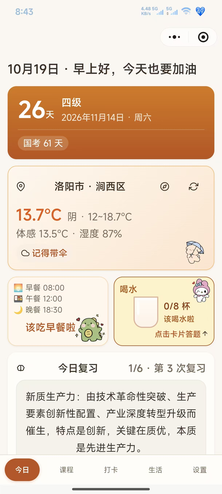
    <figcaption style="color:var(--vp-c-text-2);font-size:0.85em;margin-top:8px;">图 1：今日页——倒计时/天气/三餐喝水/复习闪卡</figcaption>
  </figure>
  <figure style="margin:0;text-align:center;">
    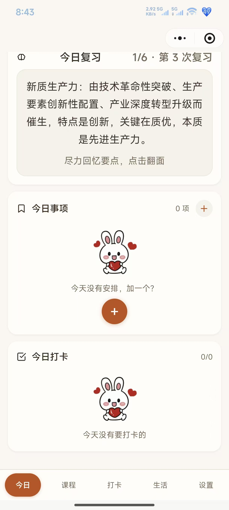
    <figcaption style="color:var(--vp-c-text-2);font-size:0.85em;margin-top:8px;">图 2：今日复习闪卡与今日事项、今日打卡</figcaption>
  </figure>
</div>

### 2. 课程与考试

考试节点模板自动识别，录播课进度落后自动标红。

<div style="display:grid;grid-template-columns:repeat(auto-fit,minmax(220px,1fr));gap:20px;margin:24px 0;">
  <figure style="margin:0;text-align:center;">
    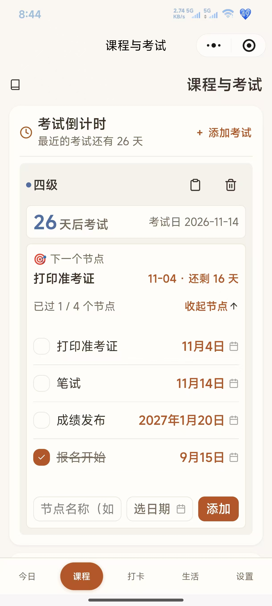
    <figcaption style="color:var(--vp-c-text-2);font-size:0.85em;margin-top:8px;">图 3：考试节点倒计时与节点模板</figcaption>
  </figure>
  <figure style="margin:0;text-align:center;">
    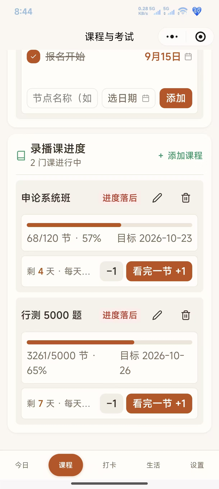
    <figcaption style="color:var(--vp-c-text-2);font-size:0.85em;margin-top:8px;">图 4：录播课进度督促（落后标红）</figcaption>
  </figure>
</div>

### 3. 打卡与心情

父子打卡项 + 热力图三档；心情五档记录生成周/月/年趋势。

<div style="display:grid;grid-template-columns:repeat(auto-fit,minmax(220px,1fr));gap:20px;margin:24px 0;">
  <figure style="margin:0;text-align:center;">
    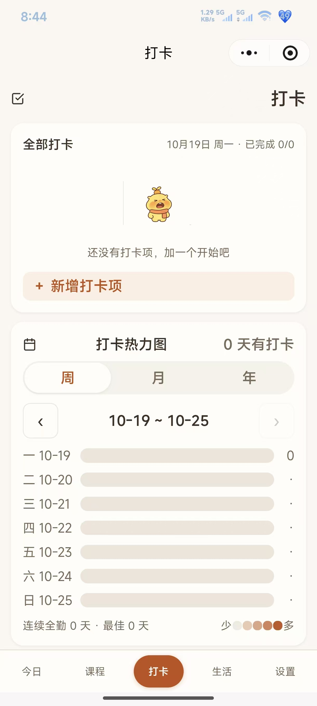
    <figcaption style="color:var(--vp-c-text-2);font-size:0.85em;margin-top:8px;">图 5：打卡热力图</figcaption>
  </figure>
  <figure style="margin:0;text-align:center;">
    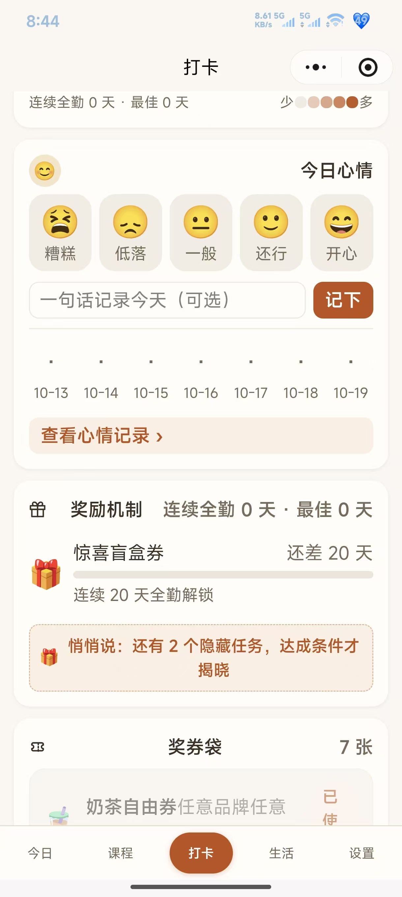
    <figcaption style="color:var(--vp-c-text-2);font-size:0.85em;margin-top:8px;">图 6：今日心情五档记录</figcaption>
  </figure>
  <figure style="margin:0;text-align:center;">
    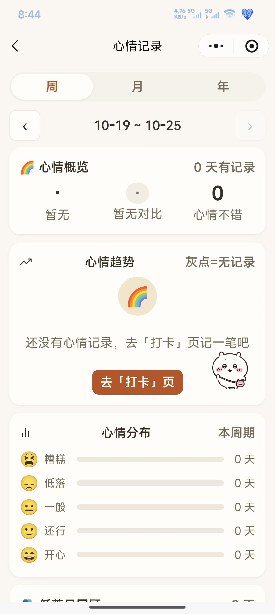
    <figcaption style="color:var(--vp-c-text-2);font-size:0.85em;margin-top:8px;">图 7：心情周/月/年趋势与分布</figcaption>
  </figure>
</div>

### 4. 奖券激励

任务达成发放奖券、集满触发惊喜盲盒；发放权在 B 端。

<figure style="margin:24px 0;text-align:center;">
  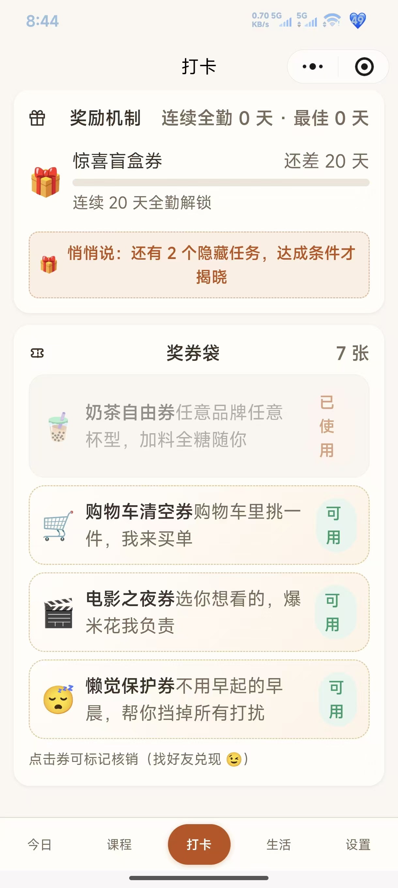
  <figcaption style="color:var(--vp-c-text-2);font-size:0.85em;margin-top:8px;">图 8：奖券袋与惊喜盲盒</figcaption>
</figure>

### 5. 学习工具组

错题三态管理与刷题闭环、种花番茄钟与专注统计、时政素材标签化、场景化智能助手。

<div style="display:grid;grid-template-columns:repeat(auto-fit,minmax(220px,1fr));gap:20px;margin:24px 0;">
  <figure style="margin:0;text-align:center;">
    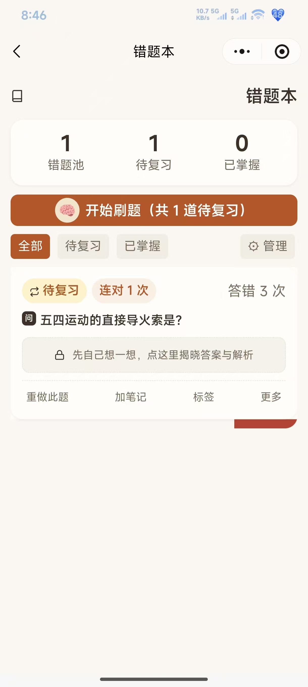
    <figcaption style="color:var(--vp-c-text-2);font-size:0.85em;margin-top:8px;">图 9：错题本三态管理</figcaption>
  </figure>
  <figure style="margin:0;text-align:center;">
    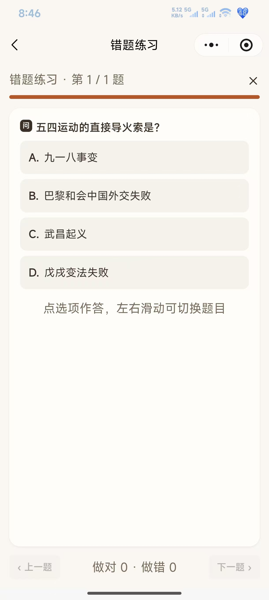
    <figcaption style="color:var(--vp-c-text-2);font-size:0.85em;margin-top:8px;">图 10：错题练习闭环</figcaption>
  </figure>
  <figure style="margin:0;text-align:center;">
    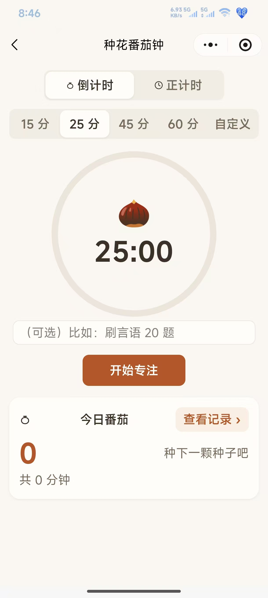
    <figcaption style="color:var(--vp-c-text-2);font-size:0.85em;margin-top:8px;">图 11：种花番茄钟</figcaption>
  </figure>
  <figure style="margin:0;text-align:center;">
    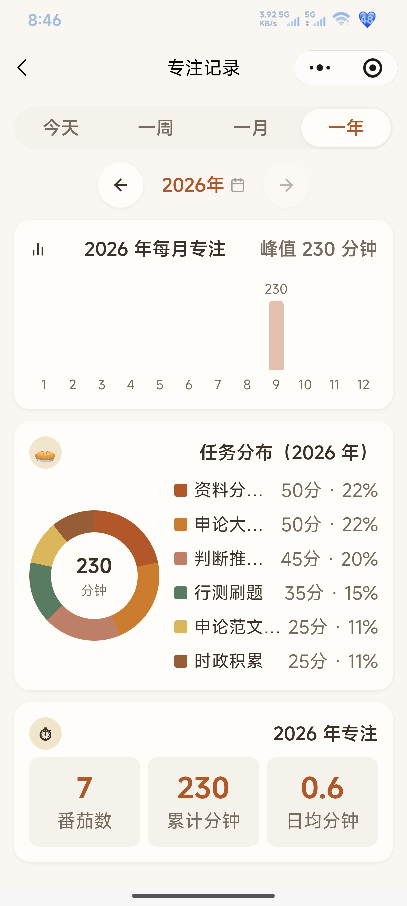
    <figcaption style="color:var(--vp-c-text-2);font-size:0.85em;margin-top:8px;">图 12：专注记录与月度统计</figcaption>
  </figure>
  <figure style="margin:0;text-align:center;">
    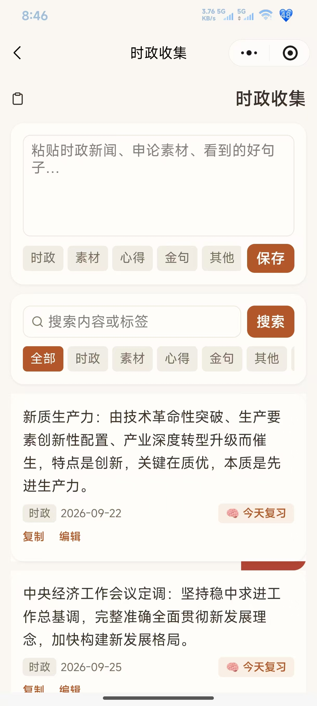
    <figcaption style="color:var(--vp-c-text-2);font-size:0.85em;margin-top:8px;">图 13：时政收集标签化沉淀</figcaption>
  </figure>
  <figure style="margin:0;text-align:center;">
    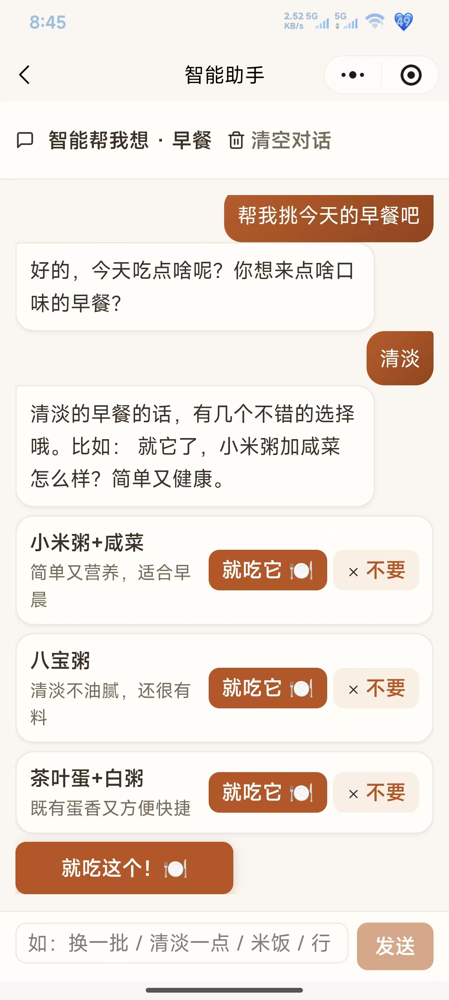
    <figcaption style="color:var(--vp-c-text-2);font-size:0.85em;margin-top:8px;">图 14：「帮我选」式智能助手</figcaption>
  </figure>
</div>

### 6. 生活管理

轻记账、待办、周期提醒、重要日期、「吃什么」转盘——琐事托管，把注意力还给复习。

<div style="display:grid;grid-template-columns:repeat(auto-fit,minmax(220px,1fr));gap:20px;margin:24px 0;">
  <figure style="margin:0;text-align:center;">
    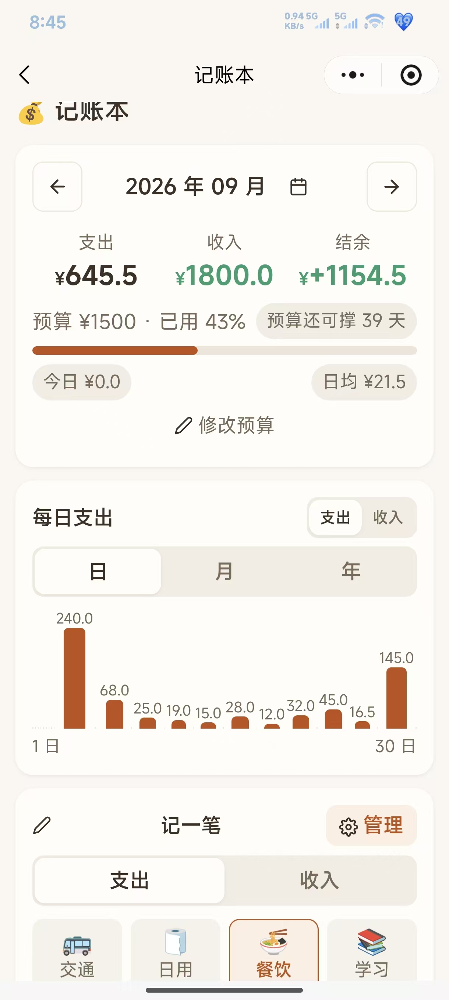
    <figcaption style="color:var(--vp-c-text-2);font-size:0.85em;margin-top:8px;">图 15：记账本收支预算与趋势</figcaption>
  </figure>
  <figure style="margin:0;text-align:center;">
    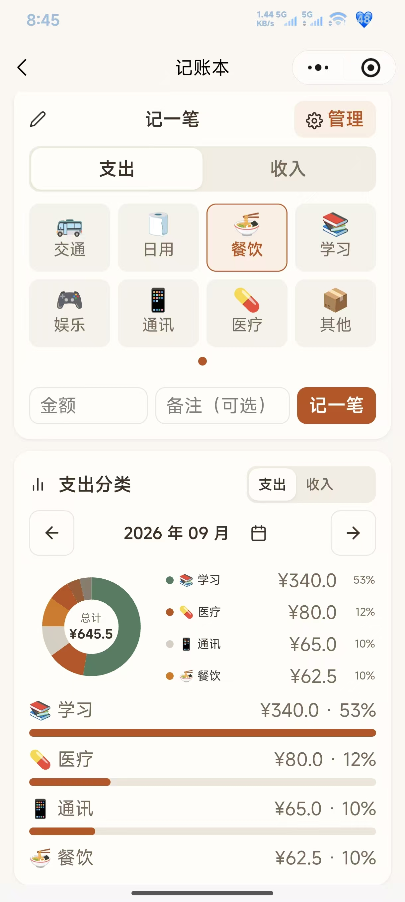
    <figcaption style="color:var(--vp-c-text-2);font-size:0.85em;margin-top:8px;">图 16：支出分类环形图</figcaption>
  </figure>
  <figure style="margin:0;text-align:center;">
    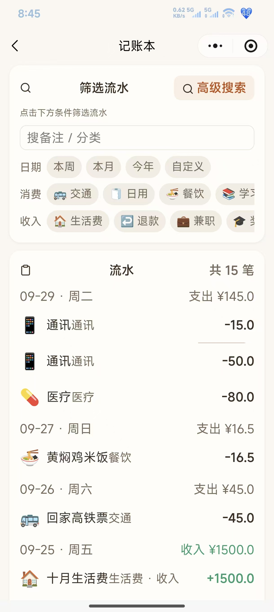
    <figcaption style="color:var(--vp-c-text-2);font-size:0.85em;margin-top:8px;">图 17：流水筛选</figcaption>
  </figure>
  <figure style="margin:0;text-align:center;">
    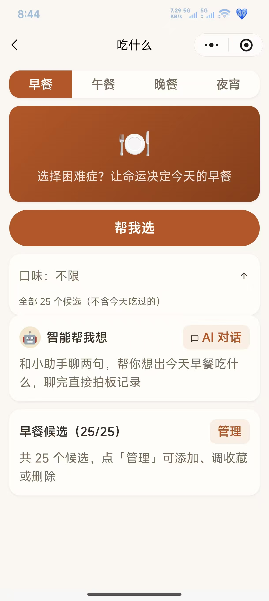
    <figcaption style="color:var(--vp-c-text-2);font-size:0.85em;margin-top:8px;">图 18：吃什么转盘抽签</figcaption>
  </figure>
  <figure style="margin:0;text-align:center;">
    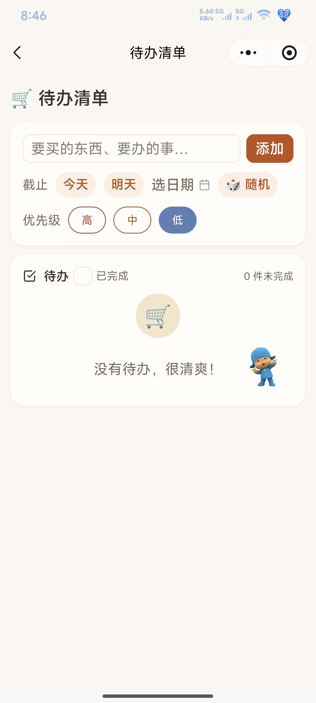
    <figcaption style="color:var(--vp-c-text-2);font-size:0.85em;margin-top:8px;">图 19：待办清单</figcaption>
  </figure>
  <figure style="margin:0;text-align:center;">
    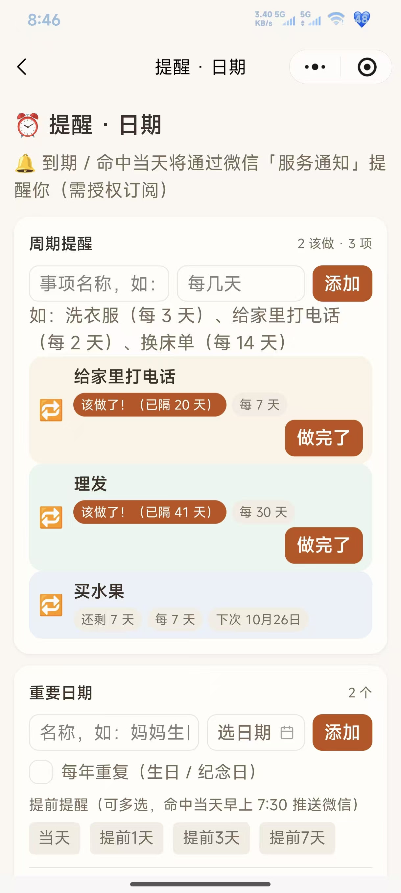
    <figcaption style="color:var(--vp-c-text-2);font-size:0.85em;margin-top:8px;">图 20：周期提醒与重要日期</figcaption>
  </figure>
</div>

## 四、系统核心机制速览

**账号与身份**：账号 = 微信 openid，无注册表单无密码（个人主体小程序拿不到手机号，openid 是体验最优解）。首开二选一：试玩（本地沙盒 `kg-guest-data`，**业务数据永不落库**，转正时用户自主决定是否带走）或正式（静默注册、全量上云）。首次选择后 180 天 token **永久免登**。

**数据同步**：业务抽象为 AppData **18 域**（exams/checkins/moods/rewards/ledger/notes…），服务端按域名分 key 存 JSON——**域结构 = API 模型，零 schema 漂移**，加字段无需后端改动。写入走**乐观更新 + 队列重试**：先落本地立即生效、失败入队、联网补传，断网可用。

**任务与奖励（核心卖点）**：三件套职责分离——任务定义在服务端（B 端 CRUD）、达成判定在用户端（需全量打卡/心情/番茄数据，**断网也能达成**）、直接发券走独立 grants 表。5 类达成条件模板（连续全勤 N 天/累计全勤/周末双满勤/连续 3 天好心情/单日 N 番茄），达成自动入袋或生成兑换码，隐藏任务达成才揭晓。

**B 端管理后台**：看板（KPI/活跃趋势/打卡热力/指标条）、用户全明细、任务与发券、备份四页；单管理员 `ADMIN_TOKEN` 口令进入，ECharts 图表，纯静态托管与小程序同域。

## 五、核心设计决策与权衡

每一项都是「考虑过什么 → 为什么选它 → 付出什么代价」的显式取舍，而非默认堆栈：

| 备选方案 | 决策 | 理由 | 付出的代价 |
|---|---|---|---|
| 白名单准入 vs 开放注册 | **注册制** | 亲友扫码即用，主理人不必逐个开白；陌生人走游客通道兜底 | 需自建游客沙盒防滥用（游客数据不落库） |
| 手机号注册 vs 微信 openid | **openid** | 个人主体拿不到手机号授权，openid 静默无感 | 账号体系绑定微信生态，无跨端账号 |
| MySQL vs SQLite | **SQLite**（自 MySQL 迁移而来） | 1 用户 ≈ 1MB/年，备份 = 拷文件，删掉整套容器运维 | 写并发弱、规模有上限（千级用户内舒适） |
| 达成判定放后端 vs 用户端 | **用户端判定** | 判定需全量本地数据且必须断网可用；沿用前端引擎零新增写接口 | 信任边界前移：客户端状态理论可被篡改（熟人规模可接受） |
| 管理员账号体系 vs 单口令 | **单 ADMIN_TOKEN** | 5 人规模，克制即正义，省掉整个 B 端登录态 | 无多管理员协作与操作审计 |
| 推送触达 vs 页面内呈现 | **页面为主 + 主动订阅** | 平台订阅消息需用户授权且有额度限制，硬推送不可靠 | 到点提醒依赖用户打开小程序，触达率让位于合规 |

## 六、技术难点与攻克

**1. 任务达成判定引擎（`pages/checkin` 968 行核心逻辑）**。难点：判定输入横跨打卡/心情/番茄三类数据，需感知父子打卡项（子项全部完成才算顶层全勤），且断网必须照常达成。解法：「**定义权在服务端、判定权在用户端**」的职责分离——B 端只下发条件模板，用户端用全量本地数据判定，判定结果作为达成状态上云。边界细则显式定义消除歧义：今天未打卡不清零连续、心情缺记录跳过不计、周末双满勤只看最近完整周末。

**2. 游客沙盒与转正数据迁移**。难点：既要陌生人零门槛试玩，又不能让脏数据灌进服务器。解法：guest 的写入后端统一返回 `{ok, discarded:true}` **接受即弃**，业务数据只活在本地 `kg-guest-data` 命名空间；转正时 `POST /auth/upgrade` 换发 user token，沙盒数据经 `PUT /data/keys` 批量上传，是否带走由用户弹窗确认——**数据主权交还用户**。

**3. 离线一致性：乐观更新 + 重试队列**。难点：备考场景地铁/自习室弱网常态，写入不能丢、也不能卡 UI。解法：写入先落本地立即生效，失败进重试队列联网补传；每个域带 `ts` 时间戳逐域 upsert 防覆盖；AppData 域结构与 API 模型一比一，让同步层与业务层零耦合。

**4. 平台合规的工程化管控**。小程序审核对敏感词零容忍。解法：把 UI 文案收敛到 `constants/copy.ts` 单点管控（如「AI」统一改写为「智能/小助手」），配 grep 验收脚本进检查流程——把合规从「人工检查」变成「工程约束」。

## 七、量化结果与系统边界

**交付规模**（单人全栈，约 3 周从零到上线 `app.gyx-a.cn`）：

- 三端 **22 个页面**（C 端 18 + B 端 4）、**20+ 个 REST 端点**
- AppData **18 域**同步模型，加字段零后端改动
- **5 类**达成条件模板、**10 项**预设任务自动 seed、**117 项**内置食物库、**6 类**考试节点模板
- **180 天** token 全程免登；艾宾浩斯复习排期完全本地计算

**系统边界（诚实声明）**：

- **触达边界**：提醒以页面内呈现为主，到点提醒依赖用户打开小程序；订阅消息需主动授权、游客不推送
- **规模边界**：SQLite 单文件承载，千级用户内舒适；更大规模需迁 MySQL（数据模型已按此预留）
- **信任边界**：达成判定在客户端，理论上可被篡改——为「断网可达 + 零新增写接口」显式接受的代价
- **统计边界**：游客业务数据不落库，B 端只能统计到访、看不到游客行为
- **后续迭代方向**：判定结果的防篡改校验、订阅消息触达优化、预聚合统计表（当前现场聚合，规模上来再优化）

## 八、立即体验

微信扫描下方小程序码，或在微信搜一搜「**上岸伴学**」直达：

<figure style="margin:24px 0;text-align:center;">
  
  <figcaption style="color:var(--vp-c-text-2);font-size:0.85em;margin-top:8px;">图 21：微信扫码直达「上岸伴学」小程序</figcaption>
</figure>
